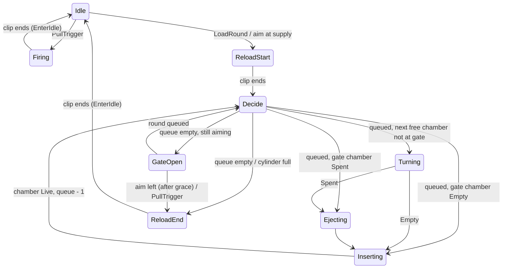
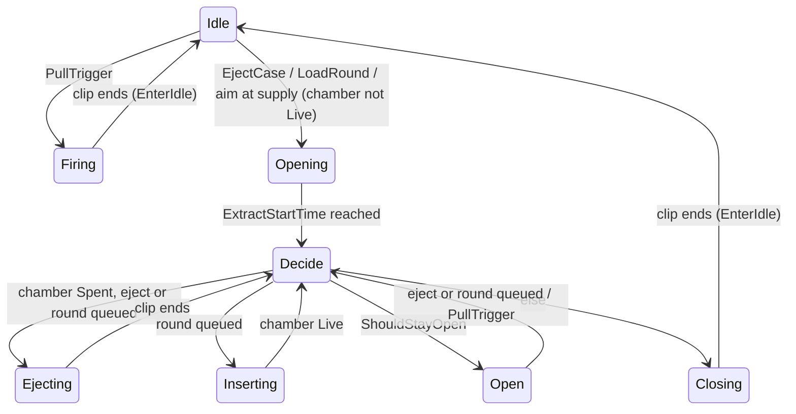
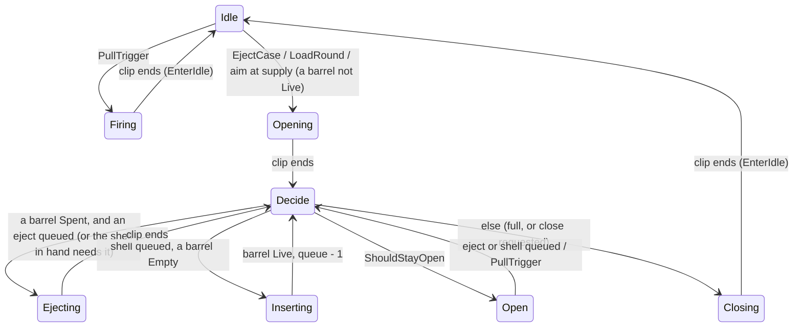

# Weapon reload — technical reference (C++)

> **For agents.** How ammo gets into the guns: input, ammo supplies, and each gun's reload state machine. The guns themselves are in [weapons](weapons.md). Design lives in [weapons](../features/weapons.md); if the code and the design disagree, the design wins. **Updated:** 2026-11-14

## Core rule
**There is no reload key.** Every round comes from a `UAmmoSupplyComponent` the player right-clicks: **one RMB click = one round** for the gun in hand (`UAmmoSupplyComponent::GiveRound` → `UGunComponent::LoadRound`). The gun decides what to do with it: queue it, open up, eject, insert, close. Supplies know nothing about guns beyond `LoadRound`, and guns know nothing about supplies beyond `SetAimingAtAmmo`.

## Files
| File | Role |
| --- | --- |
| `Source/gunsandballoons/AmmoSupplyComponent.h/.cpp` | Hands out one round per click; optional limited stock |
| `Source/gunsandballoons/AmmoCrate.h/.cpp` | Crate actor: `UAmmoSupplyComponent` + lid that opens on the first click (`IInteractable`) |
| `Source/gunsandballoons/Interactable.h` | `IInteractable` (`Interact`, `CanInteract`) |
| `Source/gunsandballoons/InteractSwap.h/.cpp` | Swaps placed actors on click; owns them, so the aim trace finds it through them |
| `Source/gunsandballoons/FirstPersonCameraPawn.cpp` | Aim trace, RMB/LMB routing (`TryTakeRound`, `TryInteract`) |
| `Source/gunsandballoons/RevolverComponent.cpp`, `RifleComponent.cpp`, `ShotgunComponent.cpp` | The reload state machines |

## Input flow (pawn, every tick, not while swapping guns)
1. **Aim:** `TraceAimedTarget` traces `InteractRange` (400 cm) on `InteractTraceChannel` (Visibility) from the camera. It walks the hit actor and its `GetOwner()` chain to the first actor that implements `IInteractable` or has a `UAmmoSupplyComponent`.
2. `ActiveGun->SetAimingAtAmmo(supply && supply->HasRounds())`, **every frame**. This is what opens a gun before the click.
3. **RMB** → `TryTakeRound()`: if the target is an `IInteractable` that `CanInteract`, call `Interact` first (opens the crate lid), then `ActiveGun->EjectCase()`: if the gun pulls out a fired case (shotgun, rifle), the click ends there and takes nothing; otherwise `Supply->GiveRound(pawn)`.
4. **LMB** → `TryInteract()`. It skips actors with an ammo supply, so LMB on a crate always reaches `PullTrigger()`.

## `UAmmoSupplyComponent` API
| Method | Kind | Behaviour |
| --- | --- | --- |
| `GiveRound(APawn*)` | BlueprintCallable | Finds the pawn's equipped `UGunComponent` and calls `LoadRound()`. On success decrements `Rounds` (unless −1) and fires `OnRoundTaken`; otherwise fires `OnRoundRefused` and takes nothing |
| `HasRounds()` | BlueprintPure | `Rounds != 0` |
| `GetRounds()` | BlueprintPure | Rounds left, −1 = unlimited |

Events: `OnRoundTaken(Supply, Pawn)`, `OnRoundRefused(Supply, Pawn)` (gun full or can't load — hook a "no" sound). Parameter: `Rounds` (default −1, design `TBD`). One ammo type for every gun.

## Shared gun contract
| Method | Revolver | Rifle | Shotgun |
| --- | --- | --- | --- |
| `CanLoadRound()` | `GetLiveRounds() + QueuedRounds < 6` | chamber not `Live` and no round queued | `GetLiveRounds() + QueuedRounds < 2` |
| `LoadRound()` | `++QueuedRounds`; opens the gate if `Idle` | `bRoundQueued = true`; opens if `Idle`, inserts if `Open` | `++QueuedRounds`; opens if `Idle`, continues if `Open` |
| `SetAimingAtAmmo(true)` | opens the gate if `Idle` and a chamber is free; holds it open between rounds | opens the breech if `Idle` and `CanLoadRound()` | opens if `Idle` and `CanLoadRound()` |
| `PullTrigger()` while open | finish the round in hand, drop the rest of the queue, close | close (load first if a round is already queued) | finish the shell in hand, drop the rest of the queue, close |
| `IsReloading()` | any state except `Idle`/`Firing` | `Opening`, `Ejecting`, `Open`, `Inserting`, `Closing` | `Opening`, `Ejecting`, `Open`, `Inserting`, `Closing` |
| `PrepareToHolster()` | stop holding, queue ≤ 1, close | stop aiming, request close | stop aiming, queue ≤ 1, request close |
| `IsReadyToHolster()` | `Idle` and queue empty | `Idle` and nothing queued | `Idle` and queue empty |
| `EjectCase()` (RMB, before `GiveRound`) | `false` (ejects on its own while loading) | `true` and `bEjectQueued` while the chamber is `Spent` and not yet queued; opens if `Idle`, continues if `Open` | `++QueuedEjects` while a `Spent` barrel is not yet queued; opens if `Idle`, continues if `Open` |

A round handed over while the gun is firing or closing is not lost. It waits, and `EnterIdle` reopens the gun for it.

## Revolver (`ERevolverState`)

- **Decide** is `ContinueReload()`. It steps forward from `GateChamber()` to the first chamber that is not `Live`. `Turning` rotates the cylinder over `max(MinTurnTime, offset × 60° / TurnDegreesPerSecond)` (clip time, divided by `ReloadPlayRate`) while holding the last frame of `Reload_Start`.
- **Ejecting:** the chamber becomes `Empty` immediately, and the case rides `case_eject`. At `CaseReleaseTime` it becomes a physics casing (`ReleaseCasing`, `OnCaseEjected`).
- **Inserting:** the round rides `round_load`. Only at the end of the clip does the chamber become `Live` (`OnRoundInserted`).
- **Holding the gate:** `ShouldHoldGateOpen()` = (aiming now, or within `GateHoldGraceTime` 0.3 s of looking away) **and** `CanLoadRound()`.
- **Trigger mid-reload** (`ReloadStart`/`Turning`/`Ejecting`/`Inserting`): `QueuedRounds = min(QueuedRounds, 1)`. The current round still goes in, then it closes. It's ignored during `Firing`/`ReloadEnd`.
- Events: `OnReloadStarted` (gate opens), `OnCaseEjected`, `OnRoundInserted`, `OnReloadFinished` (gate closed).

## Rifle (`ERifleState`)

- **Opening** (`StartOpening`): clears `bCloseRequested` and plays `Reload_Open` only up to `ExtractStartTime` (0.367 s: lever down, block dropped). A fired case stays in the chamber.
- **Ejecting** (only on a click: RMB on a supply first goes to `EjectCase()`, which takes nothing from the supply; or when a queued round needs the chamber): plays the rest of `Reload_Open` from `ExtractStartTime`. The chamber becomes `Empty`, the case rides `case_eject`, and it is released as a physics casing at `CaseReleaseTime` (0.73 s). After a shot a reload is two clicks: case out, round in.
- **Open** holds `Reload_Open` at `ExtractStartTime` (same lever and block pose as the clip's end, so it fits before and after the eject). `ShouldStayOpen()` = `CanLoadRound()` and no close request, plus, only if `bCloseWhenAimLeavesAmmo` is set, still aiming (with `GateHoldGraceTime`). The default is `false`, so the breech **stays open after looking away** until RMB on a supply or LMB (as the design asks).
- **PullTrigger:** in `Opening`/`Ejecting` it sets `bCloseRequested` and drops a queued eject, so the breech closes when the lever is down / the case is out (a queued round still goes in). In `Open` it closes now. It's ignored in `Inserting`/`Closing`/`Firing`.
- A `Live` chamber never opens: aiming at ammo does nothing, and `LoadRound` returns false.

## Shotgun (`EShotgunState`)

- **Decide** is `ContinueReload()`. Barrels are searched right first (index 0), then left, for everything: firing, ejecting, inserting.
- **Firing:** the first `Live` barrel plays `Fire_Right`/`Fire_Left`; at `ShotTime` (0.133 s, hammer strike) it becomes `Spent` and `FireShot()` runs. No live barrel: `Trigger_Dry_Right`, `OnDryFire` at `DryClickTime` (0.067 s).
- **Ejecting:** only on a click. Opening leaves the fired cases in; each RMB on a supply first goes to `EjectCase()` (one case per click, nothing taken from the supply), and only when no fired case is left does the click reach `LoadRound`. Two fired barrels = 4 clicks: eject R, eject L, load R, load L. The barrel becomes `Empty` at once, the case rides `case_eject_R/L` (`SampleCase(bone)`), and it's released as a physics casing at `CaseReleaseTime` (0.4 s).
- **Inserting:** the shell rides `shell_load`; at the end of the clip (which also cocks that barrel's hammer) the barrel becomes `Live` (`OnRoundInserted`).
- **Open** holds the last frame of `Reload_Open`; same `ShouldStayOpen()` / `bCloseWhenAimLeavesAmmo` rule as the rifle. With both barrels live it closes by itself.
- **PullTrigger** in `Opening`/`Ejecting`/`Inserting`: `bCloseRequested`, `QueuedRounds = min(QueuedRounds, 1)`, `QueuedEjects = 0`. Remaining spent cases are left in unless the shell in hand needs that barrel. In `Open` it closes now; ignored in `Firing`/`Closing`.
- Times are clip time at play rate 1 (`FirePlayRate` 1.5, `ReloadPlayRate` 1.5). Full reload from two spent barrels ≈ 3.6 s of animation plus four clicks.

## Connecting a new system
- **Ammo pouch on the basket wall / any ammo source:** add `UAmmoSupplyComponent` to the actor. It needs a primitive that blocks `Visibility`, within 400 cm of the camera. Actors it owns count too (`SetOwner`). To get a lid or other click reaction, also implement `IInteractable` on the same actor. RMB calls `Interact` and then takes the round in the same click.
- **Limited ammo:** set `Rounds` per instance. The pawn stops opening guns at an empty supply (`HasRounds()` false).
- **Sounds / UI:** gun events (above) and `OnRoundTaken` / `OnRoundRefused` on the supply; `AAmmoCrate::OnOpened` for the lid.
- **Different ammo per gun:** not designed (open question in [weapons](../features/weapons.md)). The natural place is a check in `GiveRound` before `LoadRound` — confirm with a human first.
- **Reload for a new gun:** implement the contract table above. Keep these rules: one `LoadRound` = one round; a handed-over round is never dropped; `SetAimingAtAmmo` may open the gun; `PullTrigger` closes an open gun without firing; `IsReloading()` true while open, so the pawn shows the reload pose.

## Known limitations and pitfalls
- **LMB while still aiming at a supply with room in the gun:** the gun closes, then `EnterIdle` sees the aim and reopens it at once. You can't fire at a crate while a chamber is free. On the revolver, LMB during `ReloadStart` with nothing queued is effectively ignored (it goes to `GateOpen`).
- `GiveRound` only feeds the **equipped** gun. While a swap is in progress the pawn ignores clicks, so a round can't go to the gun being put away.
- `SetAimingAtAmmo` must be called every frame. If a new caller sets it once and stops, the revolver's grace timer and the rifle's and shotgun's aim flags go stale.
- No events for "queue changed" or "ammo changed" — poll `GetLiveRounds()` / `GetQueuedRounds()`.
- Reload durations depend on clip lengths and `ReloadPlayRate` (1.5× on all three). The design lists reload time as `TBD`.
- No replication.
